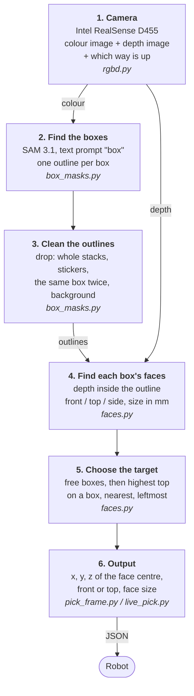

# Box picking pipeline: how it works

The camera looks at boxes in a carton. The program finds every box, works out
which faces of each box can be gripped, and picks **one target box**. It gives
the robot that box's centre point in 3D (metres from the camera).

It needs no training: SAM 3.1 finds boxes from the word "box".

Code: [`src/`](../src/); setup and use: [INTEGRATION.md](../INTEGRATION.md).
Picking rules: [picking_rules.md](picking_rules.md). New to the project? Start with the [notes](notes/README.md). Connecting a robot? See [robot_pick_logic.md](robot_pick_logic.md). Test plan and results: [plan_molmo_sam.md](plan_molmo_sam.md).

## Diagram



## The steps

| Step | What happens | Input → output | File |
|---|---|---|---|
| 1. Camera | The D455 takes a colour picture and a depth picture (how far away each pixel is). Its motion sensor tells which way is up. | → colour, depth, up direction | `rgbd.py` |
| 2. Find the boxes | SAM 3.1 is asked for "box" and draws an outline around each one, with a confidence score. | colour → outlines | `box_masks.py` |
| 3. Clean the outlines | Throws away outlines that are not one box: one around a whole stack, one around a sticker on a box, a second copy of the same box, or one covering most of the picture. | outlines → one outline per box | `box_masks.py` |
| 4. Find the faces | Takes the depth points inside each outline and finds the flat faces. A face pointing at the camera is **front**, one pointing up is **top**, anything else is **side** (never picked). It measures each face in mm. The camera often has no depth in a strip along a box's left or right edge (its depth shadow); those pixels are put on the face's flat plane, so the face is measured to its real edge, but not where the strip could be the box's own side. | outlines + depth → faces per box | `faces.py` |
| 5. Choose the target | Drops boxes that have another box resting on them (the box on top goes first), and boxes with another box in front of them (in the way, or hiding part of them). Of the rest: boxes standing on another box first, the highest top first; then the nearest, then the leftmost box. Only outlines with a front or top face count as boxes here. Its pick face is the bigger of its front and top faces; a top seen almost edge-on (its front edge under 10°), or narrower than the front, loses to the front. | faces → one target | `faces.py` |
| 6. Output | Prints the target as JSON. It also draws an overlay picture: green = front face, blue = top face, red cross = target. | target → JSON + picture | `pick_frame.py`, `live_pick.py` |

Example output:

```json
{"x_m": -0.052, "y_m": 0.032, "z_m": 0.336, "approach": "front",
 "u": 543.0, "v": 431.0, "size_mm": [134, 41], "num_boxes": 27}
```

`x` is right, `y` is down, `z` is away from the camera, in metres. `u`, `v` is the same point in the picture, in pixels.

## What the marks on the picture mean

| Mark | Meaning |
|---|---|
| Thin yellow line | the box's outline from SAM 3.1 |
| Yellow dot | "here is a box": the point deepest inside the outline. Not where the robot grips. |
| Green / blue fill | front face / top face, from depth |
| White rectangle + cross | the measured pick face and its centre |
| "(box on it)" after a label | another box rests on this one, so it is not picked yet |
| Red rectangle + cross | the target |

## Do all the boxes have to be the same size?

**No.** Nothing in the pipeline expects one box size:

- SAM 3.1 finds anything that looks like a box, whatever its size or print.
- Each box's faces are measured separately, from its own depth points.
- The target is chosen by position (on a box with the highest top, nearest, left), not by size.

Your live test on 2026-10-20 shows this: one picture had **27 boxes of different kinds and sizes** (Raspberry Pi, "hey bud" and Waveshare boxes, from 53 × 32 mm to 172 × 26 mm faces), and every box got an outline and its faces.

Boxes side by side on the floor are taken from the left whatever their height: a flat box goes before a taller box to its right.

An older YOLO model (not in this package) is different: it was trained only on Waveshare boxes, so it only knows that one kind.

## On the robot

The robot stops, takes a few frames (3–5), and asks for one answer:

```python
from pick_frame import PickDetector
from faces import up_from_pitch
detector = PickDetector()                     # once at start-up (~5 s)
UP = up_from_pitch(0)                         # the camera doesn't tilt: set once (degrees down)
result = detector.detect_frames([(color, depth_m), ...], intr, UP)
```

Each frame is run on its own; the target most frames agree on is returned as the median of those frames (for a top: the frame that found the most of it), with `"frames"` and `"agreeing"`. Fewer than half agreeing means the frames disagree: take new ones. The result is in camera coordinates; the robot converts it with the camera's position on the robot at that moment.

## How to run it

From `src/`:

```bash
.venv/bin/python live_pick.py --log outputs/live_pick/targets.jsonl   # live camera, window + JSON log
.venv/bin/python pick_frame.py --live                                 # one frame, then stop
.venv/bin/python pick_frame.py --live --frames 5                      # robot stopped: 5 frames, one answer
.venv/bin/python pick_pipeline.py --capture captures/desk             # a saved frame
.venv/bin/python eval_masks.py ../../dataset/BoxDetectionv2.yolo26/valid --video   # test against labels
```

First time on a new PC: `./setup.sh`. It downloads SAM 3.1 (3.5 GB). No Hugging Face account is needed.

## Results so far and known limits

| Check | Result |
|---|---|
| 54 labelled frames (test 2) | every box found exactly once; no boxes joined together; 0.26 s per frame |
| Live camera, 16–21 Oct | 9,550 results logged; 8% (732) had no target. Cause found: a side-only sliver nearer than the real boxes; fixed on 21 Oct |
| Speed, live | about 0.5–0.7 s per update (more boxes = slower) |
| GPU memory | about 4.3 GB (RTX 5060 Ti) |

Known limits:

- **Things outside the carton count as boxes too** (for example a blue case on the desk). If one sits in front of the carton, it could become the target. Fix: only look inside the carton.
- **A box's side face is sometimes outlined as its own box.** Harmless: a side face is never picked.
- **Not yet known:** which GPU the robot has, and how long one pick decision may take.
