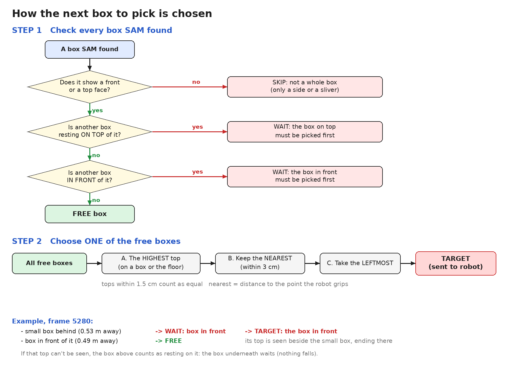

# Picking rules

How the vision pipeline chooses **which box** to pick and **which face** to pick it by. The pipeline only reports the **centroid** of that face and **how to approach it** (from the front or from above). Everything after that is up to the robot.

These rules are what `src/faces.py` (`choose_target`) does.

---

## 1. The robot can pick from the front or from above, never from the side

| Face points | Picked? | Approach |
|---|---|---|
| **At the camera** | yes | from the front |
| **Up** | yes | from above |
| **Left or right** | **never** | — |

The direction of each face comes from the depth points (plane fitting), not from how the box looks.

---

## 2. Which face of a box: the front, or on the base the larger face

The rules are in one file, [`pick_rules.py`](../src/pick_rules.py), in three groups. Only faces that point **at the camera** (front) or **up** (top) count.

| Rule | Box | Picked by |
|---|---|---|
| **Front rule** | a box **on another box** | its **front**, whatever its top shows: for a top the robot would have to reach in over the stack |
| **Base rule** | a box **on the base** (no box under it) | the **larger** of its front and top: a flat box lying on the floor from above, an upright box from the front |
| **Top rules** | when a top counts at all | see below: as wide as its front, not seen too flat |

**Last resort, with a flag:** a box on another box with no front found, only its top, is picked by its top. The robot still picks it; the pick loop raises a `flag` event (reason `top face only`, with photos) and shows a notice in the window. The target's JSON has `"top_only": true`.

**Top faces mode** (Advanced tab: **F**, or `--top-faces`): every box as on the base, the larger of its front and top wherever it is. This is how it worked before 5 Nov 2026.

| Box | Faces that count | Picked by (base rule) |
|---|---|---|
| **Turned box** | the narrow end faces the camera and its top faces up | compare their sizes and pick the **bigger** face |
| **Upright box**, big face at the camera | the front, and its top | the front is bigger than its top, so pick it **from the front** |
| **Box lying flat** | the top (its big face), and maybe its front edge | the top is the big face, so pick it **from above** |

**Face size** is the face's real size in 3D, from the depth points.

**Top seen at a very flat angle:** if the camera sees a top's front edge at less than 10° (almost edge-on), its depth is poor and its size unreliable. When the box has a front, the front is used, and the "top" is dropped: at that angle the real top is a row or two of pixels, so what was found as top is the front's upper part (shiny, its depth noisy). Those pixels go back to the front, which then measures its full height (a flat box's 13 mm front becomes its real 22 mm). The angle is taken at the front edge, not the top's centre: the far part of a slanted top often has no depth, so the centre of what was found moves between frames, and the choice would flip.

**A top must be as wide as its box's front** (within 20%, along the edge they share). A narrower "top" is a sliver of the box underneath, seen in a gap, not this box's top. The top's width counts all of the box's outline at the top's height (within 1 cm) or without depth, joined to the top: depth on a slanted top comes out slightly bent, and the depth shadow can cover an end, so its plane alone can miss an end of it. A sliver gains nothing: the pixels beside it are at other heights.

**Measuring a top seen at a slant:** the depth camera reads only parts of it: the front strip, a strip at the back, or the whole top, changing from frame to frame. So a top is re-measured from what is measured well. Its front edge is where the box's front face is; its height is the higher of the front's top edge and the top's own points (each reads low when it misses the edge). The top is level, so each image row above the front edge lies at one distance, and the top row of the box's outline (the colour picture's edge, sharp) is the back edge. The back edge is that, unless the depth reaches more than 1.5 cm past it (a box on the top hides its back, so the outline stops short): then the depth's. Depth reaching less far past it is smeared past the edge (a 100 mm top read as 109). The outline isn't used when it has spilled onto what's behind the box (its top row isn't at the top's height) or makes the box deeper than 30 cm. The grip point is halfway between the front and back edges. Of several frames that agree, the one with the biggest top gives the answer.

- **Partly hidden face** (e.g. another box on top of it): use the face's **full size** from the box size learned from the basket (planned, not built yet). Until that's known, use the visible size.

---

## 3. Which box

1. **Nothing on top:** a box with another box resting on it is never the target; the box on top goes first, even if it stands further back. (A box rests on another when its bottom is within 3 cm of the other's top height, above the other's middle and not more than 1.5 cm below its top, it overlaps it side to side, and it stands at most 30 cm behind its front and at most 3 cm in front of it. A box lying flat may stick out further towards the camera, as long as the back of its top (its front plus the top's front-to-back size) reaches 2 cm behind the lower box's front: a top box pushed 4.5 cm forward on a stack is still on it. "Above the middle" matters for thin boxes lying flat: one 2.6 cm thick is thinner than the 3 cm, and a box standing on the floor beside it is not on it; when only its top is seen, the bottom of the box beside it is below that top.)
2. **Nothing in front:** a box with another box in front of it waits; the box in front goes first. A box on top of a stack is not blocked by the stack below it, even when it stands further back than the stack's front.
3. **The highest top first:** of the boxes left (the *free* boxes), on a box or on the floor, keep the ones whose top is within 1.5 cm of the highest top. Stacks are cleared from the top down, even when the top of a stack stands a few cm further back than a lower box. A box is then never taken from under a stack or from beside its supports while that stack still stands, so pulling it can't tip or drag the boxes above. A tall box standing on the floor goes before a lower stack (since 5 Nov 2026; before, boxes on a box always came first and floor boxes weren't ranked by height). By height, not by how many boxes are under it: a pile of four thin boxes is lower than one flat box lying on tall standing boxes.
4. **Nearest, then leftmost:** of those, keep the ones whose grip point is within 3 cm of the nearest one (the arm reaches less deep, and boxes behind come free); then the leftmost. Nearest before leftmost on purpose: a gripper reaching for a box set back beside one that sticks out can catch the nearer box.

A box whose pick face runs off the edge of the picture can be the target: its grip point is the middle of the part in view (off the real centre by half the hidden part).

**Never the target** (but still in the way of others):
- a box that **nothing holds up**: not down at the floor (the lowest box bottom in view) and not on a box that is held up itself. The AI takes pieces of the carton's rim at the top of the picture for boxes; they float above the camera. A box seen only from above (bottom not visible) gets the benefit of the doubt;
- a box the robot **gave up on** (3 failed tries, then a flag), known by its outline in the picture (the camera doesn't move during a session), until `reset`;
- a box **passed over** with T in the window, until the next successful pick;
- every box under a box given up on or passed over, all the way down: nothing is pulled from under a pile. When that leaves no box, the passed-over boxes are taken back.

**Two boxes pressed together**, fronts level, are one outline to the AI. A front about twice as thick as at least 3 other fronts of the same length in view is split in two, and each half is measured as a box.

**In front** means either of:
- **In its way:** another box is nearer by more than 1.5 cm, at the same height, and across from it side to side with less than 3 cm to spare (a gripper can't use a narrow gap).
- **Hiding part of it:** a nearer box (by more than 1.5 cm) touches its bottom edge in the picture, and the camera can see that box's top **beside** it, ending less than 2 cm behind its front. Then it isn't standing on that box but behind it, and the box in front goes first.
  - A top only a few pixels tall (too thin to be found as a face) is read straight from the depth: the points in the lower box's outline at its top's height. Only when seen at 10° or more: flatter, the depth can't show where a top ends.
  - Only the columns where the top, if it ran on past the box above, could be seen doing so: a nearer box looks wider, and its top's sides draw in with distance, so in its outermost columns the top always seems to end short of a box set back on it.
  - Not in the columns of other boxes resting on the lower box: a box standing on it hides its top there.
  - When the boxes under it show no top beside it (the box above covers them all), a **twin**'s top tells instead: a box of the same kind in the same row (front the same size within 7%, as near within 1.5 cm, top as high within 1 cm), seen beside it. Same kind, same depth front to back. (A white box standing behind a row of small green boxes: the green boxes under it hide their tops, the green box beside it shows its top ending 2 cm short of the white box's front.)
  - A top read straight from the depth ends at its 90th percentile, not the 98th: the outline's edge pixels catch what's behind at the same height.

  If that top can't be seen there (a level camera sees tops edge-on, or the box in front is no wider than the box above it), the camera can't tell "on top" from "behind". The box above then always counts as **resting on** it, so the box underneath waits: nothing is ever pulled out from under a box. The price: the robot may have to reach over a box for the one behind it.

The overlay marks waiting boxes: "(box on it)" for rule 1, "(box in front)" for rule 2. The flowchart is drawn by [`images/draw_pick_logic.py`](images/draw_pick_logic.py).

---

## 4. Output

| Field | Meaning |
|---|---|
| centroid | 3D centre of the chosen face, in metres |
| approach | `front` or `top` |

---

## Open questions

| Question | Options |
|---|---|
| Two pickable faces of almost the **same size** | prefer `front` / prefer `top` / either |
| How far a face may be tilted and still count as "at the camera" or "up" | start with 30°, tune on the robot |
