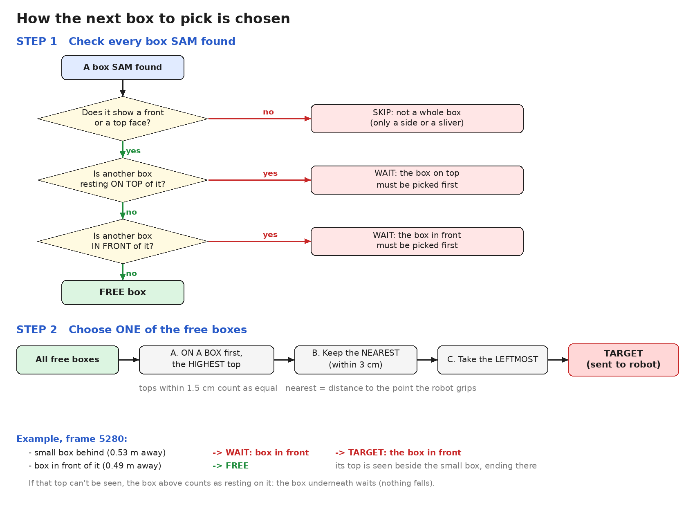

# Picking rules

How the vision pipeline chooses **which box** to pick and **which face** to pick it by. The pipeline only reports the **centroid** of that face and **how to approach it** (from the front or from above). Everything after that is up to the robot.

These rules are what `src/faces.py` (`choose_target`) does.

---

## 1. The robot can pick from the front or from above, never from the side

| Face points | Picked? | Approach |
|---|---|---|
| **At the camera** | yes | from the front |
| **Up** | yes | from above |
| **Left or right** | **never** | — |

The direction of each face comes from the depth points (plane fitting), not from how the box looks.

---

## 2. Which face of a box: the larger of the pickable faces

For each box, look only at its faces that point **at the camera** or **up**, and pick the **larger** one.

| Box | Faces that count | Picked by |
|---|---|---|
| **Turned box** | the narrow end faces the camera and its top faces up | compare their sizes and pick the **bigger** face |
| **Upright box**, big face at the camera | the front, and its top | the front is bigger than its top, so pick it **from the front** |
| **Box lying flat** | the top (its big face), and maybe its front edge | the top is the big face, so pick it **from above** |

**Face size** is the face's real size in 3D, from the depth points.

**Top seen at a very flat angle:** if the camera sees a top's front edge at less than 10° (almost edge-on), its depth is poor and its size unreliable. When the box has a front, the front is used. The angle is taken at the front edge, not the top's centre: the far part of a slanted top often has no depth, so the centre of what was found moves between frames, and the choice would flip.

**A top must be as wide as its box's front** (within 20%, along the edge they share). A narrower "top" is a sliver of the box underneath, seen in a gap, not this box's top.

**Measuring a top seen at a slant:** the depth camera reads only parts of it: the front strip, a strip at the back, or the whole top, changing from frame to frame. So a top is re-measured from what is measured well. Its front edge is where the box's front face is; its height is the higher of the front's top edge and the top's own points (each reads low when it misses the edge). The top is level, so each image row above the front edge lies at one distance, and the top row of the box's outline (the colour picture's edge, sharp) is the back edge. The back edge is the further of that and the depth's. The outline isn't used when it has spilled onto what's behind the box (its top row isn't at the top's height) or makes the box deeper than 30 cm. The grip point is halfway between the front and back edges. Of several frames that agree, the one with the biggest top gives the answer.

- **Partly hidden face** (e.g. another box on top of it): use the face's **full size** from the box size learned from the basket (planned, not built yet). Until that's known, use the visible size.

---

## 3. Which box

1. **Nothing on top:** a box with another box resting on it is never the target; the box on top goes first, even if it stands further back. (A box rests on another when its bottom is within 3 cm of the other's top height, above the other's middle and not more than 1.5 cm below its top, it overlaps it side to side, and it stands at most 30 cm behind its front. "Above the middle" matters for thin boxes lying flat: one 2.6 cm thick is thinner than the 3 cm, and a box standing on the floor beside it is not on it; when only its top is seen, the bottom of the box beside it is below that top.)
2. **Nothing in front:** a box with another box in front of it waits; the box in front goes first. A box on top of a stack is not blocked by the stack below it, even when it stands further back than the stack's front.
3. **On a box first, the highest top first:** of the boxes left (the *free* boxes), boxes standing on another box come before boxes on the floor, and of those, keep the ones whose top is within 1.5 cm of the highest top. Stacks are cleared from the top down, even when the top of a stack stands a few cm further back than a lower box. A box is then never taken from under a stack or from beside its supports while that stack still stands, so pulling it can't tip or drag the boxes above. By height, not by how many boxes are under it: a pile of four thin boxes is lower than one flat box lying on tall standing boxes. Boxes on the floor are not ranked by height: a flat box on the left goes before a tall box to its right.
4. **Nearest, then leftmost:** of those, keep the ones whose grip point is within 3 cm of the nearest one (the arm reaches less deep, and boxes behind come free); then the leftmost.

**Never the target** (but still in the way of others):
- a box whose pick face is **cut off by the edge of the picture**: its centre isn't known;
- a box that **nothing holds up**: not down at the floor (the lowest box bottom in view) and not on a box that is held up itself. The AI takes pieces of the carton's rim at the top of the picture for boxes; they float above the camera. A box seen only from above (bottom not visible) gets the benefit of the doubt;
- a box the robot **gave up on** (3 failed tries, then a flag), known by its outline in the picture (the camera doesn't move during a session), until `reset`.

**Two boxes pressed together**, fronts level, are one outline to the AI. A front about twice as thick as at least 3 other fronts of the same length in view is split in two, and each half is measured as a box.

**In front** means either of:
- **In its way:** another box is nearer by more than 1.5 cm, at the same height, and across from it side to side with less than 3 cm to spare (a gripper can't use a narrow gap).
- **Hiding part of it:** a nearer box (by more than 1.5 cm) touches its bottom edge in the picture, and the camera can see that box's top **beside** it, ending there. Then it isn't standing on that box but behind it, and the box in front goes first.

  If that top can't be seen there (a level camera sees tops edge-on, or the box in front is no wider than the box above it), the camera can't tell "on top" from "behind". The box above then always counts as **resting on** it, so the box underneath waits: nothing is ever pulled out from under a box. The price: the robot may have to reach over a box for the one behind it.

The overlay marks waiting boxes: "(box on it)" for rule 1, "(box in front)" for rule 2. The flowchart is drawn by [`images/draw_pick_logic.py`](images/draw_pick_logic.py).

---

## 4. Output

| Field | Meaning |
|---|---|
| centroid | 3D centre of the chosen face, in metres |
| approach | `front` or `top` |

---

## Open questions

| Question | Options |
|---|---|
| Two pickable faces of almost the **same size** | prefer `front` / prefer `top` / either |
| How far a face may be tilted and still count as "at the camera" or "up" | start with 30°, tune on the robot |
