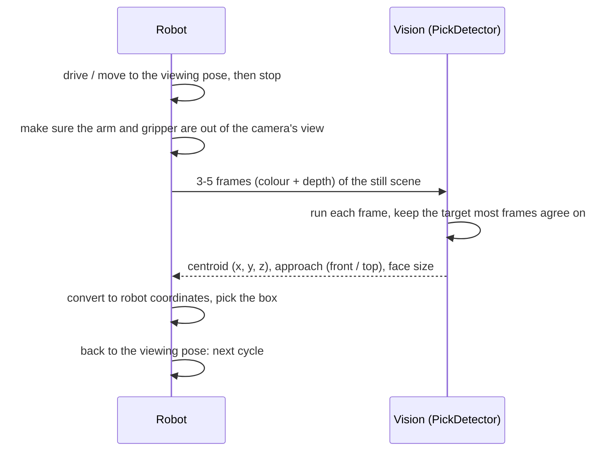

# Robot pick logic

How the robot asks the vision pipeline which box to pick, what it gets back, and what to do with it.

The vision side never moves the robot. It looks at the boxes and answers one question: **which box next, where is the centre of the face to grip, and from which side (front or top)**. Everything after that (path, grip, place) is the robot's.

Background: [architecture.md](architecture.md) (how the pipeline works), [picking_rules.md](picking_rules.md) (the rules in full), [notes/](notes/README.md) (the ideas, for newcomers).

## The cycle



1. **Stop.** Frames must come from a camera that isn't moving.
2. **Clear the view.** The gripper or a box in the gripper is seen as part of the scene (a box held in the air is still a box, and can become the target).
3. **Take 3–5 frames** and pass them all in one call.
4. **Check the answer** (next section), then pick.
5. **After every pick, look again.** Picking one box can move others. Never reuse an old answer.

## The call

```python
from pick_frame import PickDetector
from faces import up_from_pitch

detector = PickDetector()          # once at start-up: loads SAM 3.1 (~5 s, ~4.3 GB GPU memory)
UP = up_from_pitch(0)              # the camera's tilt, set once (degrees down; 0 = level)

result = detector.detect_frames([(color, depth_m), ...], intr, UP)
```

| Input | What it is |
|---|---|
| `color` | colour image, BGR, `uint8`, H × W × 3 (1280 × 720 on the D455) |
| `depth_m` | depth in metres, `float32`, H × W, **aligned to the colour image** (0 = no reading) |
| `intr` | the colour camera's intrinsics (`faces.Intrinsics(fx, fy, cx, cy)`) |
| `UP` | which way is up, in camera coordinates. The camera is fixed and doesn't tilt, so this never changes |

`rgbd.Camera` in [`src/rgbd.py`](../src/rgbd.py) gives aligned frames and intrinsics straight from the D455, if the vision PC owns the camera. Frames from elsewhere (ROS topic, files) work too: `detect_frames` only needs the arrays. For a robot program in another Python or language, use `src/pick_server.py` ([INTEGRATION.md](../INTEGRATION.md)).

**Time:** about 0.3–1 s per frame, more with more boxes in view (SAM 3.1 about 0.25–0.5 s, depth 0.05–0.7 s). 5 frames ≈ 2–5 s.

## The answer

```json
{"x_m": -0.0605, "y_m": 0.2008, "z_m": 0.563, "approach": "top",
 "u": 574.6, "v": 599.1, "size_mm": [169, 102], "num_boxes": 1,
 "frames": 5, "agreeing": 5}
```

| Field | Meaning |
|---|---|
| `x_m`, `y_m`, `z_m` | **where to grip**: the centre of the chosen face, in metres, in **camera coordinates**: x right, y down, z forward (away from the lens) |
| `approach` | `"front"`: come at the face horizontally, towards the camera's side of the box. `"top"`: come down from above |
| `size_mm` | the face's long × short edge, mm |
| `u`, `v` | the same centre in image pixels (for drawing and checking) |
| `num_boxes` | boxes seen |
| `frames`, `agreeing` | frames given, and how many of them found this same target. The answer is the **median** of those that agree; for a top, the frame that saw the most of the top |

`null`: no pickable box in any frame.

### What to do with it

| Answer | Robot does |
|---|---|
| `null` | no box to pick: the carton is empty, or nothing reachable. Check the view, or report done |
| `agreeing` < half of `frames` | the frames disagree (something moved, or a hard scene): take new frames |
| otherwise | convert `x, y, z` to robot coordinates with the camera's pose at the moment of the frames (hand-eye calibration), then pick from the `approach` side |

## Pick, check, next

After each pick the camera checks whether the box was really taken (the **pick check**, by the Pick Check team), with no second run of SAM: it compares the depth inside the target's outline before the pick (the median of the 5 frames the target came from) and after (3 new frames, when the robot says `done`). Then:

| Check says | Next |
|---|---|
| success | the next box |
| failed (missed, moved, dropped, wrong box) | pick again: usually the same box (a retry). After 2 retries on the same box a **flag** is raised for a person, with photos of the box (the scene with it marked, a close-up, the last check), and the box is **skipped**: never chosen again (until `reset`), but it still blocks the boxes behind and under it |
| can't tell (an arm or hand still in view) | wait for the next `done` and check again; after 3 in a row (something new stays in view), new pictures and a new choice |

The camera only says which box and whether the pick worked; when the pick is over is the robot's to say (`done`). All of this runs in one program, [`pick_loop.py`](../src/pick_loop.py), which owns the camera. The robot base must not move between the target and the check.

## How the target is chosen

The robot always gets **one** box. The rules, in order:

1. **Only front or top faces.** A face pointing at the camera is picked from the front, a face pointing up from above. A side face (left/right) is never picked.
2. **The bigger face wins.** Of a box's front and top, the larger in real size. A top counts only if it is as wide as the front (else it's a sliver of another box), and if its front edge is seen at 10° or more (else it's almost edge-on and measured badly); otherwise the front is used.
3. **Nothing on top of it.** A box with another box resting on it waits: the one on top goes first.
4. **Nothing in front of it.** A box with another box in its way, or with a nearer box hiding part of it, waits: the box in front goes first. A box lying on top of a stack is *not* blocked by the stack below it. When the camera can't see whether a box stands **on** a nearer box or **behind** it (a level camera sees tops edge-on), it counts as *on*: nothing is pulled out from under a box, but the robot may have to reach over a box. Details: [picking_rules.md](picking_rules.md).
5. **On a box first, the highest top first.** Of the free boxes, those standing on another box come before those on the floor, and of those the ones whose top is within 1.5 cm of the highest. Stacks are cleared from the top down, even when a stack's top stands a few cm further back. Boxes on the floor are not ranked by height.
6. **Nearest, then leftmost.** Of those, the ones whose grip point is within 3 cm of the nearest one, then the leftmost.


So a stack is cleared from the top down, the front boxes go before the ones behind, and nothing is pulled from under another box, or from beside the boxes holding up a stack, while that stack stands.

## Coordinates

```
            z (forward, away from the lens)
           /
          /
 camera  o-------- x (right)
         |
         |
         y (down)
```

- Metres, from the colour camera's optical centre.
- The robot needs the **camera's pose on the robot** (hand-eye calibration) to turn this into its own frame. Because the robot stops before each look, the pose at capture time is the pose at answer time.

## Assumptions the robot side must keep

| Assumption | Why it matters | If it's broken |
|---|---|---|
| The camera is fixed and doesn't tilt | "up" is set once; it decides front vs top, levels tops, and finds boxes resting on others | wrong `approach`, wrong tops; pass the new `UP` |
| `UP` matches the real mounting | as above | set `up_from_pitch(<degrees down>)` once, or read the camera's accelerometer (needs the librealsense udev rules) |
| The robot is still while the frames are taken | the answer combines the frames | `agreeing` drops; results smear |
| Arm and gripper out of view | anything box-like is a box | a held box can become the target |
| Depth aligned to colour | every pixel's depth must match its colour pixel | sizes and centres are wrong |
| Boxes about 0.35–0.6 m from the camera (what has been tested) | depth noise grows with distance | at 0.5 m the centre moves ~1 mm frame to frame; further away, more. Test before using other distances |

## What it can get wrong (check on the robot)

- **Two boxes pressed together** (side by side, or one lying on the other) with their fronts level are drawn as one outline by the AI. When the doubled face is about twice as thick as other boxes of the same length in view (at least 3 of them), it is split in two and the left or top one is picked. Alone, or among boxes of other sizes, it can't be told: check `size_mm` against the boxes you expect. If a box really is twice as thick as its neighbours of the same length, it is split by mistake; the grip point then lands a quarter of the way across that box, still on it.
- **Anything box-shaped counts**, including things outside the carton (a case on the table). Keep the view to the carton, or tell us to limit the search to it.
- **A top seen at a flat angle** (camera nearly level with it) is measured less well; its size can be 5–10 mm off.

## Not returned yet

- **Rotation of the face.** The answer gives the centre and the approach side, not how the face is turned (a box standing at an angle). The pipeline measures it (each face's normal and edges); tell us if the gripper needs it, and it can be added to the answer.
- **Which box comes next.** Only the current target; the next one is decided after the next look.
