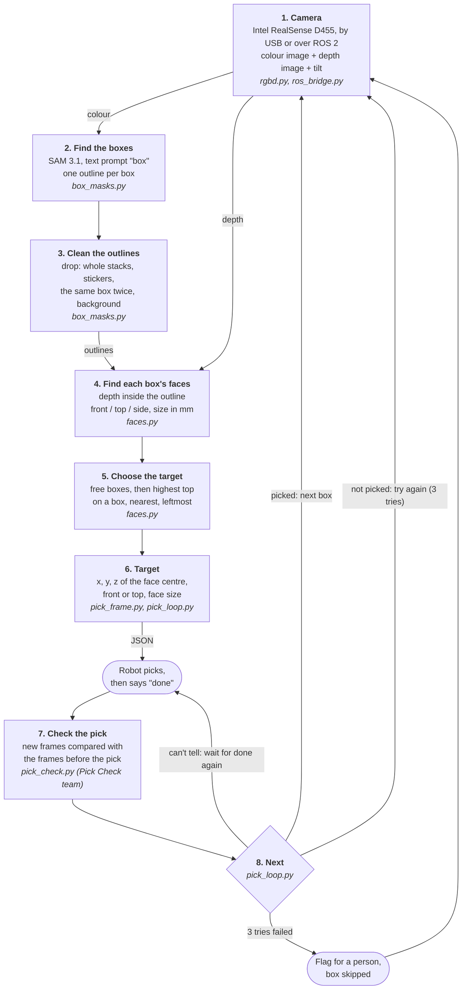

# Box picking pipeline: how it works

The camera looks at boxes in a carton. The program finds every box, works out
which faces of each box can be gripped, and picks **one target box**. It gives
the robot that box's centre point in 3D (metres from the camera). After the robot
says it has picked, the camera checks whether the box is really gone, and then
the next box is chosen.

It needs no training: SAM 3.1 finds boxes from the word "box".

Code: [`src/`](../src/); setup and use: [INTEGRATION.md](../INTEGRATION.md) and [RUN_LIVE.md](../RUN_LIVE.md).
Picking rules: [picking_rules.md](picking_rules.md). New to the project? Start with the [notes](notes/README.md). Connecting a robot? See [robot_pick_logic.md](robot_pick_logic.md). Test plan and results: [plan_molmo_sam.md](plan_molmo_sam.md).

## Diagram



## The steps

| Step | What happens | Input → output | File |
|---|---|---|---|
| 1. Camera | The D455 takes a colour picture and a depth picture (how far away each pixel is), lined up pixel for pixel. Plugged in by USB, or on another machine that sends it over ROS 2 (`--ros`). Which way is up: over USB, from the D455's motion sensor (leave out `--pitch`; needs the RealSense USB rules); over ROS 2, from `--pitch` (the camera's tilt in degrees). | → colour, depth, up direction | `rgbd.py`, `ros_bridge.py` |
| 2. Find the boxes | SAM 3.1 is asked for "box" and draws an outline around each one, with a confidence score. Outlines under the cut-off are dropped: 0.4 in the pick loop (`--score`, or SAM confidence in the window). Thin boxes standing on end score only 0.45–0.6. | colour → outlines | `box_masks.py` |
| 3. Clean the outlines | Throws away outlines that are not one box: one around a whole stack, one around a sticker on a box, a second copy of the same box, or one covering most of the picture. | outlines → one outline per box | `box_masks.py` |
| 4. Find the faces | Takes the depth points inside each outline and finds the flat faces. A face within 30° of pointing at the camera is **front**, within 30° of pointing up is **top**, anything else is **side** (never picked). A box turned further, with no front or top, gets the face turned most towards the camera as its front. Each face is measured in mm. The camera often has no depth in a strip along a box's left or right edge (its depth shadow); those pixels are put on the face's flat plane, so the face is measured to its real edge. A top seen at a slant is measured from the outline too: its width across all of the outline at the top's height, its far edge from the outline's edge (depth readings run a little past it). | outlines + depth → faces per box | `faces.py` |
| 5. Choose the target | Drops boxes that have another box resting on them (the box on top goes first), and boxes with another box in front of them (in the way, or hiding part of them). Of the rest, order **v1** (the default): boxes standing on another box first, the highest top first; then the nearest, then the leftmost. Order **v2** (`--order v2`): simply the leftmost. Never the target: a box that nothing holds up (pieces of the carton's rim), boxes skipped after failed tries or passed over with T, and every box under those, all the way down. A box running off the picture's edge can be the target: its grip point is the middle of the part in view. Its pick face is the bigger of its front and top; a top seen almost edge-on (its front edge under 10°), or narrower than the front, loses to the front. | faces → one target | `faces.py` |
| 6. Target | The robot stands still; 5 frames (`--frames`) are each run through steps 2–5, and the target most of them agree on is the answer. It is printed as a JSON `target` event. | target → JSON | `pick_frame.py`, `pick_loop.py` |
| 7. Check the pick | The robot picks the box and writes `done` once the arm is out of view. 3 new frames (`--check-frames`) are compared, pixel for pixel, with the frames from before the pick: is the depth inside the target's outline gone (picked), the same (missed), or changed in another way? Printed as a JSON `result` event. | frames before + after → verdict | `pick_check.py` (Pick Check team, used unchanged) |
| 8. Next | Picked: the next box. Not picked: the picker chooses again, usually the same box. After 3 tries on one box (`--retries 2`), a `flag` event with photos is raised for a person and the box is skipped. Can't tell (an arm or hand still in view): wait for the next `done`. | verdict → next step | `pick_loop.py` |

Example target:

```json
{"x_m": -0.052, "y_m": 0.032, "z_m": 0.336, "approach": "front",
 "u": 543.0, "v": 431.0, "size_mm": [134, 41], "num_boxes": 27, "frames": 5, "agreeing": 5}
```

`x` is right, `y` is down, `z` is away from the camera, in metres. `u`, `v` is the same point in the picture, in pixels.

## The window

`pick_loop.py` shows a window for testing (`--no-window` for the robot). Drawing: `loop_screen.py`.

- **Main picture:** the live camera, with the target's pick face boxed in red and a red cross on the grip point. The top bar shows the step: find, pick, check, next.
- **PICK tab:** the target's x / y / z, a close-up, which try this is, how many frames agreed, and how long finding it took. Keys: **C** done (stands in for the robot), **T** next target, **S** snapshot, **A** the Advanced tab, **Q** quit.
- **ADVANCED tab:** switches for the depth picture (**D**) and the picker's own view of all boxes (**V**), the order (**O**), look again (**N**), forget skipped boxes (**R**), and − / + for frames per target, SAM confidence and frames per pick success.

The picker's own view (V, `live_pick.py`, saved overlays) marks:

| Mark | Meaning |
|---|---|
| Thin yellow line | the box's outline from SAM 3.1 |
| Yellow dot | "here is a box": the point deepest inside the outline. Not where the robot grips. |
| Green / blue fill | front face / top face, from depth |
| White rectangle + cross | the measured pick face and its centre |
| "(box on it)" after a label | another box rests on this one, so it is not picked yet |
| Red rectangle + cross | the target |

## Do all the boxes have to be the same size?

**No.** Nothing in the pipeline expects one box size:

- SAM 3.1 finds anything that looks like a box, whatever its size or print.
- Each box's faces are measured separately, from its own depth points.
- The target is chosen by position (on a box with the highest top, nearest, left), not by size.

Your live test on 2026-10-20 shows this: one picture had **27 boxes of different kinds and sizes** (Raspberry Pi, "hey bud" and Waveshare boxes, from 53 × 32 mm to 172 × 26 mm faces), and every box got an outline and its faces.

An older YOLO model (not in this package) is different: it was trained only on Waveshare boxes, so it only knows that one kind.

## On the robot

The robot runs `pick_loop.py --no-window` and talks to it in lines of text: it reads `target` events from stdout and writes `done` (or `done held` / `done empty`), `pick`, `reset` on stdin. Details: [robot_pick_logic.md](robot_pick_logic.md) and [INTEGRATION.md](../INTEGRATION.md).

From Python, the picker alone:

```python
from pick_frame import PickDetector
from faces import up_from_accel, up_from_pitch
detector = PickDetector(score=0.4)            # once at start-up (~5 s)
UP = up_from_accel(cam.accel)                 # or up_from_pitch(degrees down) without the motion sensor
result = detector.detect_frames([(color, depth_m), ...], intr, UP)
```

Each frame is run on its own; the target most frames agree on is returned as the median of those frames (for a top: the frame that found the most of it), with `"frames"` and `"agreeing"`. Fewer than half agreeing means the frames disagree: take new ones. The result is in camera coordinates; the robot converts it with the camera's position on the robot at that moment.

## How to run it

From `src/` (all commands: [RUN_LIVE.md](../RUN_LIVE.md)):

```bash
.venv/bin/python pick_loop.py                                         # pick + check loop, D455 by USB (tilt from its motion sensor), with the window
.venv/bin/python pick_loop.py --ros --pitch 0                         # camera over ROS 2: give the tilt
.venv/bin/python pick_loop.py --no-window                             # for the robot
.venv/bin/python live_pick.py                                         # the picker alone, live
.venv/bin/python pick_pipeline.py --capture "outputs/pick_loop/*/snapshots/snap_*" --score 0.4   # saved snapshots
```

First time on a new PC: `./setup.sh`. It downloads SAM 3.1 (3.5 GB). No Hugging Face account is needed. For the motion sensor over USB, the RealSense USB rules (once):

```bash
sudo wget -O /etc/udev/rules.d/99-realsense-libusb.rules https://raw.githubusercontent.com/IntelRealSense/librealsense/master/config/99-realsense-libusb.rules
sudo udevadm control --reload-rules && sudo udevadm trigger      # then unplug and replug the camera
```

## Results so far and known limits

| Check | Result |
|---|---|
| 54 labelled frames (test 2) | every box found exactly once; no boxes joined together; 0.26 s per frame |
| Live camera, 16–21 Oct | 9,550 results logged; 8% (732) had no target. Cause found: a side-only sliver nearer than the real boxes; fixed on 21 Oct |
| Pick loop, by hand (C for `done`) | picked, missed, retries, flag and skip, over USB and over ROS 2 |
| Sizes, 3 Nov (boxes 170 × 100 × 25) | ArUco markers (26 mm) measure 25–26 mm. Standing: front 169–172 × 98–107. Lying flat, with the camera's real tilt: top 167–170 × 96–101 |
| Speed | about 2–3 s from frames to target with 5 frames; about 0.5 s per frame |
| GPU memory | about 4.3 GB (RTX 5060 Ti) |

Known limits:

- **Not yet run with real robot picks.**
- **A top seen at a shallow angle depends on the camera's tilt.** At 46 cm away and 20 cm above, one pixel is about 2.5 mm front to back, and 1° of tilt error moves the top's depth 5–6 mm (a 100 mm top read as 109 with `--pitch 0` on a camera tilted 1.9°). Over USB the motion sensor gives the real tilt; over ROS 2, `--pitch` must be right.
- **No depth at the picture's left and right edges** (about 4 cm at the left at 45 cm away, less at the right). Boxes there can't be measured. This is the camera, not the code.
- **White, shiny tops get patchy depth**, so their size can come out short in one frame and right in the next; the 5-frame answer smooths it out.
- **Things outside the carton count as boxes too** (for example a blue case on the desk). If one sits in front of the carton, it could become the target. Fix: only look inside the carton.
- **A box's side face is sometimes outlined as its own box.** Harmless: a side face is never picked.
- **Not yet known:** which GPU the robot has.
